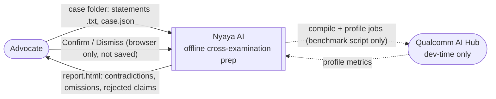
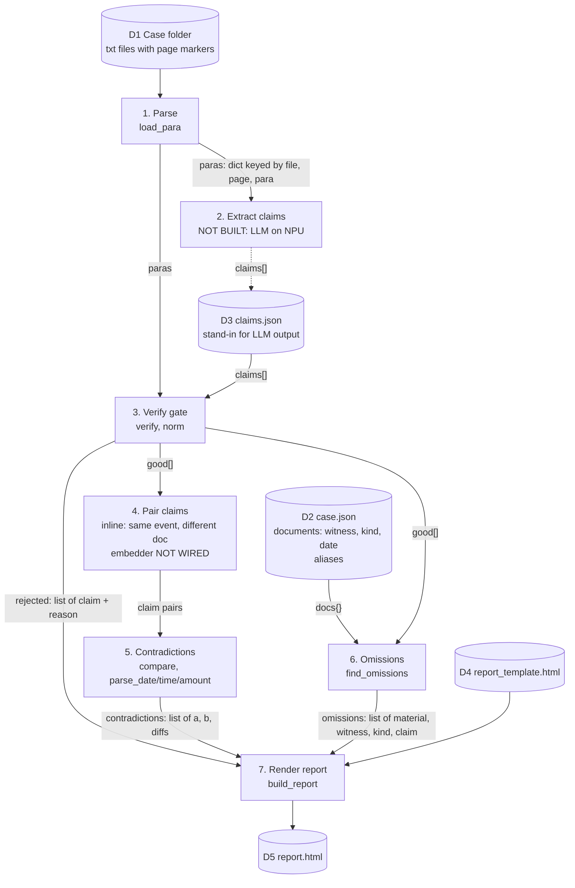

# Nyaya AI: reverse-engineered architecture (as of commit c168b36)

Reverse-engineered from [nyaya.py](../nyaya.py), [report_template.html](../report_template.html), [benchmarks/profile_embedder.py](../benchmarks/profile_embedder.py) and `sample_case/`.
Legend: solid = built, dashed = planned / stubbed.

## 1. Context diagram (DFD level 0)



Nothing leaves the laptop at run time. AI Hub is used only by the benchmark script.

## 2. DFD level 1 (data flow through the pipeline)



Notes from the code:
- `claims.json` is hand-written, with 3 planted bad claims. It is the only thing standing in for stage 2.
- `case.json` `aliases` is **never read**. It exists for future actor/witness resolution.
- Pairing (stage 4) is the inline `a["event"] == b["event"] and a["doc"] != b["doc"]` loop in `__main__`, O(n²) over verified claims.
- Contradictions do not look at witness or doc kind. Any two docs with the same event label are compared, including different witnesses (PW1 vs PW2).
- Omissions are per witness and need both an `earlier` and a `court` document.

## 3. Component map

| # | Component | Code | Input | Output | Runs on | Status |
|---|---|---|---|---|---|---|
| 1 | Parser | `load_para` | folder of `.txt` with `[page N]` lines, blank-line paragraphs | `{(file,page,para): text}` | CPU | built |
| 2 | Claim extractor | none | paragraphs | claim JSON | NPU (Genie, ~3B INT4) | planned |
| 3 | Verification gate | `verify`, `norm` | claim, paras | `None` or reject reason | CPU | built |
| 4 | Pairing | inline loop; `profile_embedder.py` | verified claims | claim pairs | NPU (MiniLM, ORT QNN) | label match built, embedder profiled only |
| 5 | Contradiction engine | `compare`, `parse_date`, `parse_time`, `parse_amount` | claim pair | list of differing fields | CPU | built |
| 6 | Omission engine | `find_omissions`, `MATERIAL_HINTS` | good claims, docs metadata | ranked omissions | CPU | built |
| 7 | Report renderer | `build_report`, `quote`, `cite`, `BUTTONS` + template | all results | `report.html` | CPU | built |
| 8 | Benchmark | `profile_embedder.py` | HF model | AI Hub profile URL | cloud device | built |

## 4. Data schemas

**Paragraph key:** `(filename, page_no, para_no)`, both 1-based, so every quote has a citation.

**Claim** (the contract between extractor and everything downstream):
```
doc, page, para            citation, must exist in paras
actor, event               event is the pairing key (free-text label, e.g. "accused_arrives")
date, time, place, amount  optional; must appear inside exact_quote
exact_quote                must appear in the cited paragraph (after lowercase + whitespace collapse)
```

**Document metadata (case.json):** `witness`, `kind` (`earlier` | `court`), `date`.

**Findings:**
- Contradiction: `(claimA, claimB, ["date"|"time"|"place"|"amount", ...])`
- Omission: `(is_material, witness, "said first in Court..." | "told police...", claim)`
- Rejection: `(claim, reason)`

## 5. Rules embedded in code (the business logic)

| Rule | Where | Value |
|---|---|---|
| Quote must be in cited paragraph | `verify` | normalised substring |
| Date/time/place/amount must be in quote | `verify` | normalised substring |
| Date conflict | `compare` | ranges don't overlap; `12/13.03.2021` is a range |
| Time conflict | `compare` | more than 30 min apart |
| Place conflict | `compare` | normalised strings differ |
| Amount conflict | `compare` | integers differ (`Rs.` prefix only) |
| Materiality | `find_omissions` | substring of event label in `MATERIAL_HINTS` |

## 6. Gaps to a full-fledged system (observations, not decisions)

1. **Everything is hard-wired to `sample_case/`.** There is no CLI, config, or multi-case concept.
2. **No ingestion beyond `.txt`.** No PDF/OCR, no auto-detection of witness or document kind. Both come from a hand-written `case.json`.
3. **Extractor is missing.** The claim schema is the contract it must meet; `event` labels need a controlled vocabulary or embeddings, because label equality is the only pairing mechanism today.
4. **`aliases` unused.** No actor resolution (PW-1 vs Ramesh vs complainant).
5. **Pairing ignores witness.** Cross-witness comparison is probably unintended.
6. **Place and amount matching are brittle.** "house" vs "his house" flags a contradiction; only `Rs.` amounts parse.
7. **Materiality is a keyword match on the event label**, not the text.
8. **Confirm/Dismiss is lost on reload.** No persistence, no export.
9. **No tests.** Correctness is shown only by the sample-case run.
10. **Report path hard-codes cwd** (`report_template.html` is read relative to cwd).
11. **No legal grounding in the output.** The s.148 BSA / s.181 BNSS references appear only in the README.
